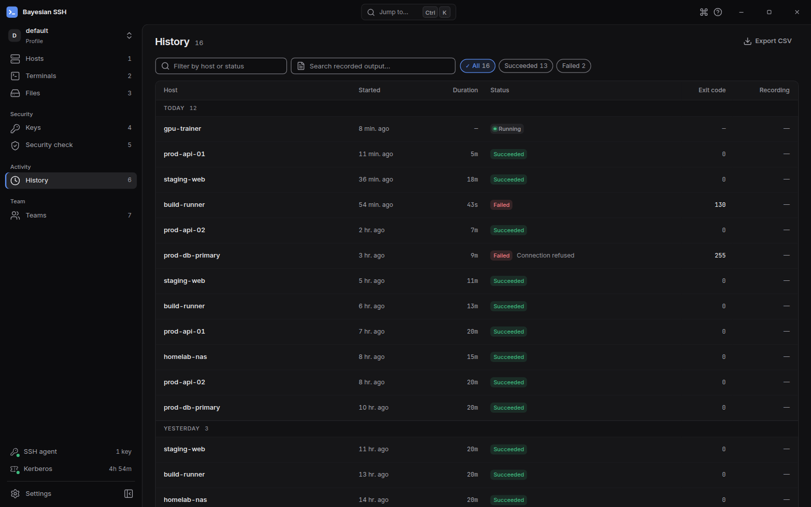

import { CardGrid, LinkCard, Tabs, TabItem } from '@astrojs/starlight/components';

Bayesian SSH registra cada conexión en su base de datos local, guardando las marcas de tiempo de inicio, la duración y el estado de salida. Puedes inspeccionar sesiones pasadas, analizar tus patrones de uso y gestionar las conexiones en ejecución desde la línea de comandos o la aplicación de escritorio.

## Ver el historial de sesiones

Ejecuta `bssh history` para mostrar las sesiones SSH recientes.

```sh
bssh history
```

La salida muestra un encabezado de resumen seguido de las sesiones recientes, de la más nueva a la más antigua:

```text
📋 Session History

────────────────────────────────────────────────────────────────────────────────────────
📊 Summary: 4 sessions | ✅ 3 successful (75.0%) | ❌ 1 failed | ⏱️  Avg duration: 12m 45s
────────────────────────────────────────────────────────────────────────────────────────

SESSION    CONNECTION           STARTED              DURATION     STATUS          EXIT CODE
────────────────────────────────────────────────────────────────────────────────────────
3f2a91c0 ● web-prod             2026-10-23 09:14:22  18m 10s      Success         0
8c4e12a9   db-primary           2026-10-23 08:30:05  42m 02s      Success         0
1b7d55f0   bastion-ext          2026-10-23 07:15:40  2m 11s       Error           255
f4a10e82 ● staging-api          2026-10-22 17:05:12  5m 28s       Success         0
```

Cada fila incluye:

- **SESSION**: Un prefijo de 8 caracteres del UUID de la sesión. Un marcador `●` junto al identificador indica que existe una grabación de sesión disponible.
- **CONNECTION**: El nombre de la conexión guardada.
- **STARTED**: Marca de tiempo en que se abrió la conexión.
- **DURATION**: Tiempo total transcurrido, o `ongoing` para sesiones activas.
- **STATUS**: Estado de la sesión (`Success`, `Error`, `Terminated` o `Active`).
- **EXIT CODE**: El código de salida SSH remoto, o `-` si finalizó de manera anómala.

Al ejecutar `bssh history`, `bssh` detecta automáticamente aquellas sesiones cuyos procesos locales ya no existen y actualiza su estado en la base de datos.

### Filtrar entradas del historial

Acota el historial mediante las opciones de la línea de comandos:

```sh
# Mostrar únicamente sesiones de una conexión específica
bssh history -c web-prod

# Limitar a las sesiones de los últimos 7 días
bssh history --days 7

# Mostrar únicamente sesiones que terminaron con error
bssh history --failed

# Modificar la cantidad de entradas mostradas (predeterminado: 20)
bssh history -n 50
```

Para buscar texto mostrado durante las sesiones grabadas, utiliza `-g` o `--grep`:

```sh
bssh history --grep "Out of memory"
```

Para obtener más información sobre las grabaciones y su reproducción, consulta [Grabación de sesión](/es/guides/recording/).

## Gestionar sesiones activas

El comando `bssh close` lista y finaliza las sesiones SSH activas iniciadas por `bssh`.

### Listar sesiones en ejecución

Ejecuta `bssh close` sin argumentos para ver todas las sesiones activas actualmente:

```sh
bssh close
```

```text
📋 Active Sessions

CONNECTION           PID        STARTED              DURATION
──────────────────────────────────────────────────────────────────────
web-prod             41208      2026-10-23 09:14:22  18m 10s 🟢
db-primary           41355      2026-10-23 08:30:05  42m 02s 🟢

💡 Use 'bssh close <connection>' to close a session
   Use 'bssh close --cleanup' to remove stale sessions
```

### Finalizar una sesión

Especifica el nombre de una conexión para terminar sus sesiones activas:

```sh
bssh close web-prod
```

`bssh` te solicita confirmación antes de enviar una señal `SIGTERM` al proceso:

```text
Close session for 'web-prod' (PID 41208)? [y/N] y
✅ Sent SIGTERM to session 'web-prod' (PID 41208)
```

Para omitir la confirmación interactiva, añade `-f` o `--force`:

```sh
bssh close web-prod -f
```

### Finalizar todas las sesiones

Para cerrar todas las sesiones activas a la vez, utiliza `-a` o `--all`:

```sh
bssh close --all -f
```

:::note
`bssh kill` es un alias de `bssh close`. Comandos como `bssh kill --all -f` realizan exactamente la misma operación.
:::

### Limpiar sesiones huérfanas

Si cerraste una ventana de terminal de forma forzada o reiniciaste el sistema operativo, pueden quedar registros marcados como activos aunque su proceso ya no exista.

Ejecuta `bssh close --cleanup` para regularizar la tabla de sesiones:

```sh
bssh close --cleanup
```

```text
🧹 Cleaned stale session: web-prod (PID 41208)

✅ Cleaned 1 stale session(s)
```

Si definiste un periodo de retención para las grabaciones, `bssh close --cleanup` también elimina las grabaciones `.cast` vencidas y sus índices de búsqueda.

## Estadísticas de uso

Ejecuta `bssh stats` para ver el total de conexiones, la actividad reciente y la distribución por etiqueta:

```sh
bssh stats
```

```text
📊 Bayesian SSH Statistics

Total Connections: 28
Most Used: web-prod (last: 2026-10-23 09:14:22)

Recently Used:
  1. web-prod - 10-23 09:14
  2. db-primary - 10-23 08:30
  3. bastion-ext - 10-23 07:15
  4. staging-api - 10-22 17:05
  5. monitoring - 10-22 14:10

Connections by Tag:
  prod: 12 connection(s)
  aws: 8 connection(s)
  database: 5 connection(s)
  staging: 3 connection(s)
```

Además de generar reportes, el historial de sesiones alimenta el motor de clasificación: cada sesión completada actualiza las probabilidades bayesianas que determinan qué host aparece primero cuando ejecutas `bssh connect`. Consulta [Búsqueda y clasificación](/es/guides/search-and-ranking/) para más detalles.

## Aplicación de escritorio

La aplicación de escritorio integra el seguimiento de sesiones en su interfaz:



- **Vista History**: haz clic en la pestaña **History** en la barra lateral para revisar sesiones pasadas. Puedes filtrar por nombre de conexión o estado, verificar marcas de tiempo y hacer clic en sesiones grabadas para abrir el reproductor integrado.
- **Terminales activos**: las pestañas de terminal en ejecución aparecen en la barra superior. Al cerrar una pestaña se finaliza el proceso SSH asociado.
- **Sesiones desconectadas**: si la aplicación de escritorio detecta sesiones ejecutándose en segundo plano, accede a ellas desde la paleta de comandos (<kbd>Ctrl</kbd>+<kbd>K</kbd>) buscando **Detached sessions**.

## Próximos pasos

<CardGrid>
	<LinkCard title="Grabación de sesión" description="Graba la salida de tus sesiones en formato asciicast y reprodúcelas." href="/es/guides/recording/" />
	<LinkCard title="Búsqueda y clasificación" description="Aprende cómo el historial influye en la clasificación bayesiana de hosts." href="/es/guides/search-and-ranking/" />
</CardGrid>
