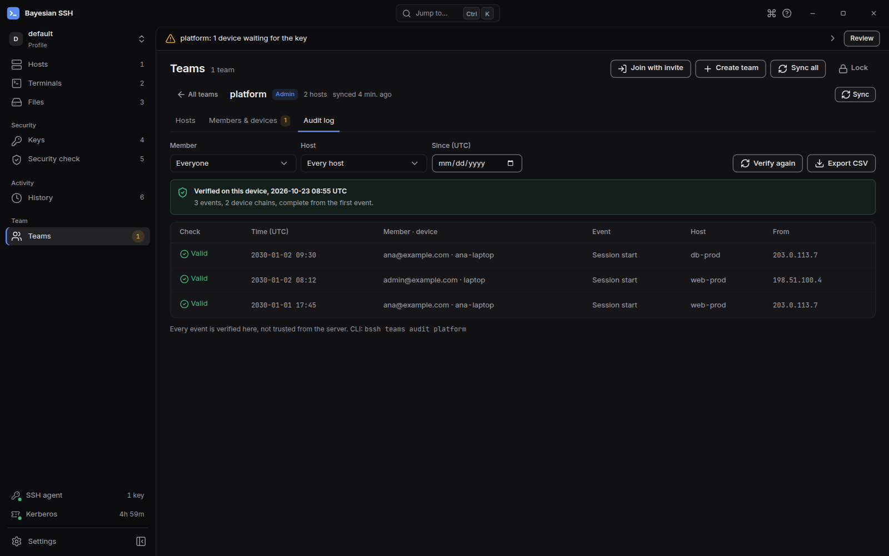

El registro de auditoría anota quién se conectó a qué host del equipo, y cuándo. El dispositivo de cada miembro escribe sus propios eventos y los firma, y los administradores verifican todo el registro en su propia máquina en lugar de confiar en el servidor.

## Qué se registra

Conectar con un host del equipo registra un evento de inicio de sesión en local, incluso sin conexión y con Teams bloqueado. El evento no necesita la frase de contraseña: en la siguiente sincronización, el dispositivo lo firma con su clave, lo encadena al evento anterior del dispositivo y lo sube, con la hora real en que empezó la sesión.

El servidor añade cuándo recibió cada evento y la dirección desde la que llegó. Esos dos campos permiten comparar lo que informó un dispositivo con lo que vio el servidor.

## Ver el registro

Los administradores leen el registro con `bssh teams audit`:

```sh
bssh teams audit platform
bssh teams audit platform --host db-prod@platform
bssh teams audit platform --member ana@example.com --since 2026-01-01
```

| Opción | Qué limita |
| --- | --- |
| `--host <CONNECTION>` | Los eventos de una conexión de equipo |
| `--member <EMAIL>` | Los eventos de un miembro |
| `--since <DATE>` | Los eventos ocurridos desde una fecha (`YYYY-MM-DD`) o una hora RFC 3339 |
| `--limit <LIMIT>` | Cuántos eventos descargar, del más reciente al más antiguo (valor predeterminado y máximo: 1000) |

El comando muestra de cada evento su hora, el miembro y el dispositivo, el evento, el host, la dirección de origen y el resultado de la comprobación. En la línea de comandos, las horas usan la hora local de la máquina. La aplicación de escritorio las muestra en UTC.

## Verificación

Cada evento se verifica en tu máquina: su firma con la clave del dispositivo autor, y la cadena de cada dispositivo con el evento anterior. No se confía en nada del servidor.

- Un evento editado o falsificado falla la comprobación de su firma.
- Un evento de un dispositivo que el equipo no conoce aparece como **Unknown device**.
- Un evento que pertenece a otro equipo aparece como **Other team**.
- Un evento reordenado o duplicado rompe la cadena de su dispositivo, y uno eliminado deja un hueco en ella.

Cuando algo falla, `bssh teams audit` muestra los problemas y termina con un código distinto de cero, así que el comando puede ejecutarse en una comprobación de cumplimiento.

## El límite de los eventos más recientes

El registro se descarga del más reciente al más antiguo, 1000 eventos por defecto y como máximo 1000 con `--limit`. Si la descarga alcanza el límite, el comando indica que solo muestra los más recientes. Los eventos descargados se verifican igualmente, pero los más antiguos no; limita con `--since` o `--host` para cubrirlos.

Hay un límite que no se puede detectar solo con el registro. Si el servidor elimina los eventos más recientes de un miembro antes de que ese miembro suba otros más recientes, lo que queda sigue siendo un registro válido. La siguiente sincronización del miembro informa entonces de un error de cadena de auditoría. La aplicación de escritorio mantiene ese aviso en pantalla, y en la entrada Teams de la barra lateral, hasta que una sincronización posterior tenga éxito. En la línea de comandos, atento al mensaje de cadena de auditoría después de una sincronización.

## En la aplicación de escritorio

Abre el equipo y elige **Audit log**. La pestaña verifica el registro en cuanto se abre, y de nuevo cada vez que cambias un filtro o eliges **Verify again**. Solo administradores.

El aviso da uno de tres veredictos:

- **Verified on this device**: cada evento comprobado, desde el primero de cada dispositivo.
- **Verified, partial: older events weren't checked**: los eventos mostrados son válidos, pero los más antiguos no se comprobaron, porque solo se descargaron los más recientes o porque el registro no empieza en el primer evento de un dispositivo.
- **Verification failed: treat this log as tampered**: los problemas aparecen listados; comprueba el registro en otra máquina de administración antes de confiar en las filas.

Filtra por **Member**, **Host** y **Since (UTC)**, y elige **Export CSV** para guardar una copia. La columna **Check** indica **Valid**, **Bad signature**, **Unknown device** o **Other team** para cada evento. Las horas están en UTC.



## Siguientes pasos

- [Sincronización](/es/teams/sync/): sube los eventos en cola e informa de una cadena rota.
- [Miembros y dispositivos](/es/teams/members/) para los roles y las huellas.
