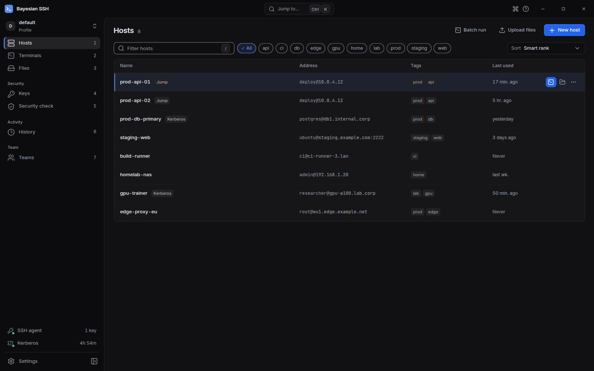
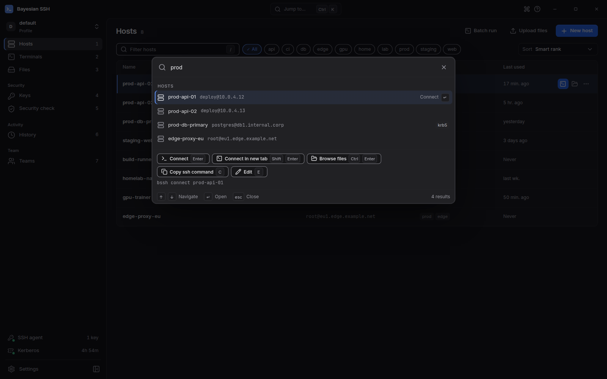
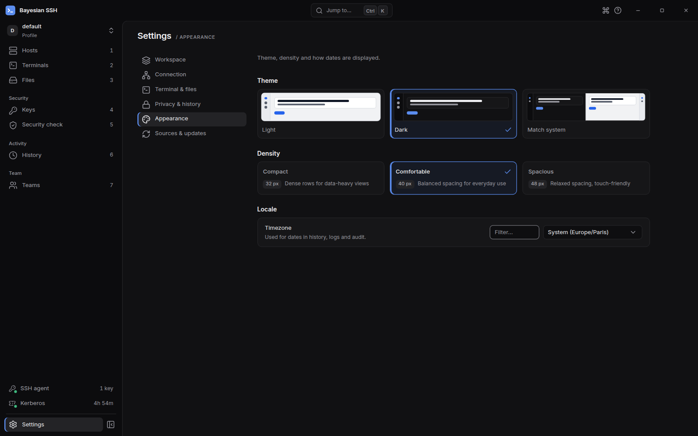

import { Tabs, TabItem, Aside } from '@astrojs/starlight/components';

Bayesian SSH propose une application de bureau pensée pour le clavier aux côtés de l'outil en ligne de commande. Les deux partagent la même base de données locale SQLite, la même configuration et les mêmes profils d'environnement.

## Lancer l'application

Lancez l'interface de bureau depuis le menu de vos applications, ou exécutez-la depuis un terminal :

```sh
bssh desktop
```

La commande démarre `bayesian-ssh-desktop` en arrière-plan, détaché de votre session de terminal. Vous pouvez également exécuter le binaire directement :

```sh
bayesian-ssh-desktop
```

Pour démarrer l'application de bureau avec un profil d'environnement spécifique, transmettez l'option `--env` :

```sh
bssh desktop --env staging
```

## Organisation de l'interface

La barre latérale organise votre espace de travail en vues dédiées :



- **Hosts** : Affichez, filtrez et recherchez les connexions enregistrées. Consultez les classements, l'état des connexions, les tags et les actions rapides.
- **Terminals** : Un émulateur de terminal multi-onglets intégré. Connectez-vous à plusieurs hôtes en parallèle, basculez ou réorganisez les onglets et effectuez des recherches dans la sortie du terminal.
- **Files** : Un gestionnaire de fichiers SFTP pour parcourir les dossiers distants, téléverser et télécharger des fichiers. Vous pouvez activer ou désactiver cette vue dans les paramètres.
- **Keys** : Inspectez les clés SSH locales, générez de nouvelles paires de clés et consultez les clés actuellement actives dans votre agent SSH.
- **Security check** : Exécutez des audits de sécurité directement depuis l'interface (`bssh audit`) pour identifier les algorithmes obsolètes, les clés manquantes ou les permissions non sécurisées.
- **History** : Consultez l'historique des sessions de connexion passées et leurs horodatages.
- **Teams** : Gérez les connexions d'équipe, les invitations de membres, l'approbation des appareils et les journaux d'audit vérifiés.
- **Settings** : Ajustez les préférences de l'application, l'apparence, les polices du terminal, les mises à jour et les profils d'environnement.

<Aside type="note">
La redirection de port locale et les proxys SOCKS se gèrent en ligne de commande avec `bssh forward` (ou `bssh tunnel`). Consultez le [guide des tunnels](/fr/guides/tunnels/) pour les options de redirection.
</Aside>

## Palette de commandes et raccourcis clavier

Ouvrez la palette de commandes depuis n'importe où en appuyant sur <kbd>Ctrl</kbd>+<kbd>K</kbd> (ou <kbd>⌘</kbd><kbd>K</kbd> sur macOS).

Depuis un onglet de terminal actif sous Linux ou Windows, appuyez sur <kbd>Ctrl</kbd>+<kbd>Shift</kbd>+<kbd>P</kbd> (<kbd>⌘</kbd><kbd>K</kbd> sur macOS) pour ouvrir la palette sans interférer avec les combinaisons de touches du shell.



La palette de commandes vous permet de rechercher des hôtes, de changer de vue, de modifier des connexions, de parcourir des fichiers et d'exécuter des actions. Appuyez sur <kbd>?</kbd>, <kbd>F1</kbd> ou <kbd>Ctrl</kbd>+<kbd>/</kbd> (<kbd>⌘</kbd><kbd>/</kbd> sur macOS) pour afficher le tableau complet des raccourcis clavier.

### Raccourcis courants

| Action | Linux / Windows | macOS | Contexte |
| --- | --- | --- | --- |
| Palette de commandes | <kbd>Ctrl</kbd>+<kbd>K</kbd> | <kbd>⌘</kbd><kbd>K</kbd> | Partout |
| Palette de commandes dans le terminal | <kbd>Ctrl</kbd>+<kbd>Shift</kbd>+<kbd>P</kbd> | <kbd>⌘</kbd><kbd>K</kbd> | Terminal |
| Paramètres | <kbd>Ctrl</kbd>+<kbd>,</kbd> | <kbd>⌘</kbd><kbd>,</kbd> | Partout |
| Tableau des raccourcis clavier | <kbd>?</kbd> / <kbd>F1</kbd> / <kbd>Ctrl</kbd>+<kbd>/</kbd> | <kbd>?</kbd> / <kbd>F1</kbd> / <kbd>⌘</kbd><kbd>/</kbd> | Partout |
| Filtrer ou rechercher | <kbd>/</kbd> | <kbd>/</kbd> | Global |
| Changer de vue par numéro (<kbd>1</kbd>–<kbd>7</kbd>) | <kbd>1</kbd> à <kbd>7</kbd> | <kbd>1</kbd> à <kbd>7</kbd> | Global |
| Nouvel hôte | <kbd>N</kbd> ou <kbd>Ctrl</kbd>+<kbd>N</kbd> | <kbd>N</kbd> ou <kbd>⌘</kbd><kbd>N</kbd> | Global |
| Se connecter à l'hôte sélectionné | <kbd>Enter</kbd> | <kbd>Enter</kbd> | Hosts |
| Se connecter dans un nouvel onglet | <kbd>Shift</kbd>+<kbd>Enter</kbd> | <kbd>Shift</kbd>+<kbd>Enter</kbd> | Hosts |
| Parcourir les fichiers | <kbd>Ctrl</kbd>+<kbd>Enter</kbd> | <kbd>⌘</kbd><kbd>Enter</kbd> | Hosts |
| Modifier l'hôte | <kbd>E</kbd> | <kbd>E</kbd> | Hosts |
| Partager avec une équipe | <kbd>S</kbd> | <kbd>S</kbd> | Hosts |
| Copier la commande ssh | <kbd>C</kbd> | <kbd>C</kbd> | Hosts |
| Supprimer l'hôte | <kbd>Delete</kbd> | <kbd>Delete</kbd> | Hosts |
| Déplacer la sélection | <kbd>↑</kbd> / <kbd>↓</kbd> ou <kbd>J</kbd> / <kbd>K</kbd> | <kbd>↑</kbd> / <kbd>↓</kbd> ou <kbd>J</kbd> / <kbd>K</kbd> | Hosts |
| Onglet de terminal suivant | <kbd>Ctrl</kbd>+<kbd>Tab</kbd> | <kbd>Ctrl</kbd>+<kbd>Tab</kbd> | Terminal |
| Onglet de terminal précédent | <kbd>Ctrl</kbd>+<kbd>Shift</kbd>+<kbd>Tab</kbd> | <kbd>Ctrl</kbd>+<kbd>Shift</kbd>+<kbd>Tab</kbd> | Terminal |
| Fermer l'onglet de terminal | <kbd>Ctrl</kbd>+<kbd>Shift</kbd>+<kbd>W</kbd> | <kbd>⌘</kbd><kbd>W</kbd> | Terminal |
| Rouvrir l'onglet fermé | <kbd>Ctrl</kbd>+<kbd>Shift</kbd>+<kbd>T</kbd> | <kbd>⌘</kbd><kbd>T</kbd> | Terminal |
| Rechercher dans la sortie du terminal | <kbd>Ctrl</kbd>+<kbd>Shift</kbd>+<kbd>F</kbd> | <kbd>⌘</kbd><kbd>F</kbd> | Terminal |
| Zoom avant / arrière / réinitialiser | <kbd>Ctrl</kbd>+<kbd>Shift</kbd>+<kbd>=</kbd> / <kbd>-</kbd> / <kbd>0</kbd> | <kbd>⌘</kbd><kbd>=</kbd> / <kbd>-</kbd> / <kbd>0</kbd> | Terminal |
| Annuler la connexion en cours | <kbd>Esc</kbd> | <kbd>Esc</kbd> | Terminal |

## Thèmes et densité

Configurez les préférences visuelles sous **Settings** → **Appearance** :



### Thèmes

- **Dark** : Thème sombre à haut contraste pensé pour les environnements peu éclairés.
- **Light** : Schéma de couleurs claires et lisibles.
- **Match system** : Bascule automatiquement entre le thème sombre et le thème clair selon les réglages de votre système d'exploitation.

### Densité des lignes

La densité contrôle l'espacement vertical des lignes dans toute l'application :

- **Compact** : Lignes de 32 px. Maximise les éléments visibles pour les inventaires volumineux.
- **Comfortable** : Lignes de 40 px. Espacement équilibré pour un usage quotidien (par défaut).
- **Spacious** : Lignes de 48 px. Espacement aéré adapté aux écrans haute résolution et tactiles.

## Mises à jour logicielles

Ouvrez **Settings** → **Updates** pour vérifier la version active et rechercher des mises à jour. Le fonctionnement dépend de votre méthode d'installation :

- **Paquet Snap** : Les mises à jour sont gérées automatiquement en arrière-plan par le Snap Store. Vous pouvez lancer une mise à jour manuelle :
  ```sh
  sudo snap refresh bayesian-ssh
  ```
- **Installation manuelle** : Si l'installation a été effectuée via `install.sh` ou le gestionnaire de paquets de votre distribution, mettez à jour en relançant le script d'installation ou via votre gestionnaire de paquets.
- **Version binaire GitHub directe** : Cliquez sur **Check for updates** pour interroger GitHub à la recherche d'une version signée plus récente. Si une mise à jour est disponible, cliquez sur **Install update** pour la télécharger et l'appliquer. L'application demande une confirmation si des sessions de terminal sont encore actives.