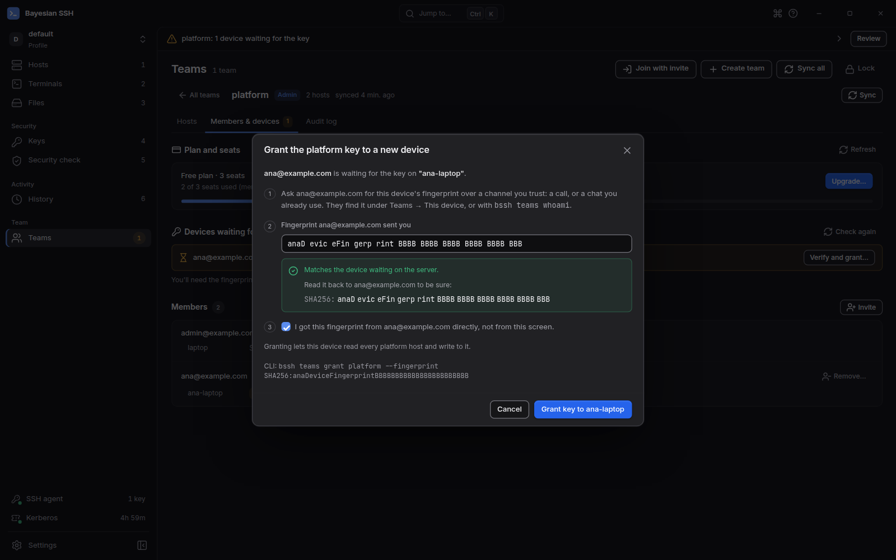

import { Steps, Tabs, TabItem } from '@astrojs/starlight/components';

Une équipe a des membres et des appareils. Chaque appareil a sa propre clé et son empreinte, et un administrateur n'accorde la clé d'équipe à un appareil qu'après avoir reçu cette empreinte de son propriétaire. C'est ce qui empêche le serveur de synchronisation d'ajouter un appareil de son cru.

Seuls les administrateurs peuvent inviter des personnes, accorder des clés, révoquer des invitations et retirer des membres.

## Inviter une personne

<Tabs syncKey="surface">
<TabItem label="Ligne de commande">

<Steps>

1. **Administrateur :** invitez le membre.

   ```sh
   bssh teams invite platform ana@example.com
   ```

   bssh affiche deux commandes pour Ana, avec un jeton à usage unique et l'empreinte de votre appareil. Envoyez-les par un canal où vous savez que c'est bien Ana.

2. **Ana :** crée son compte avec l'invitation, puis adhère en épinglant l'empreinte de l'administrateur.

   ```sh
   bssh teams init --server https://teams.example.com --email ana@example.com --invite <TOKEN>
   bssh teams join <TOKEN> --fingerprint <ADMIN FINGERPRINT>
   ```

   bssh refuse de faire confiance à l'équipe si aucun appareil administrateur de celle-ci ne porte cette empreinte. L'adhésion affiche l'empreinte de l'appareil d'Ana.

3. **Administrateur :** accordez la clé à l'appareil d'Ana.

   ```sh
   bssh teams grant platform
   ```

   La commande liste les appareils en attente de la clé. N'en accordez un qu'après qu'Ana vous a envoyé son empreinte :

   ```sh
   bssh teams grant platform --fingerprint <ANA'S FINGERPRINT>
   ```

4. **Ana :** synchronisez.

   ```sh
   bssh teams sync
   ```

   Les connexions de l'équipe apparaissent dans `bssh list`.

</Steps>

</TabItem>
<TabItem label="Application de bureau">

<Steps>

1. **Administrateur :** ouvrez l'équipe, choisissez **Members & devices**, puis **Invite**. Saisissez l'adresse et choisissez **Create invite**. L'application affiche le message à envoyer, avec les étapes pour le bureau et la ligne de commande, le jeton à usage unique, votre empreinte et l'expiration. Choisissez **Copy message**.

2. **Ana :** sur une nouvelle installation, choisissez **I was invited to a team** pendant la prise en main. Sinon, ouvrez **Teams**, choisissez **Join with invite** et collez le message entier ; l'application en lit le jeton et l'empreinte de l'administrateur. Si Teams n'est pas encore configuré, collez d'abord l'invitation sur l'écran de configuration.

3. **Administrateur :** l'appareil apparaît sous **Devices waiting for the key**. Choisissez **Verify and grant…**, collez l'empreinte envoyée par Ana et cochez la confirmation. Dans cette boîte de dialogue, l'application n'affiche jamais l'empreinte que le serveur indique pour l'appareil en attente. Une fois l'empreinte collée identique, elle s'affiche par groupes de quatre pour que vous puissiez la relire à Ana. Choisissez **Grant key to …**.

4. **Ana :** tant que la clé n'est pas arrivée, la page affiche **Waiting for an admin to grant this device the key.** Son empreinte apparaît à côté, avec un bouton **Copy**. Tant que la page est ouverte, elle vérifie toutes les 30 secondes et synchronise l'équipe dès que la clé arrive.

</Steps>

</TabItem>
</Tabs>

## Pourquoi les empreintes s'échangent par un autre canal

L'invitation contient l'empreinte de l'administrateur, et le membre l'épingle en adhérant. Si l'empreinte n'appartient à aucun appareil administrateur de l'équipe, rien n'est approuvé : un serveur ne peut pas se faire passer pour l'administrateur de l'équipe. De la même manière, un administrateur n'accorde la clé qu'à une empreinte que le membre lui a envoyée directement, pour qu'un serveur ne puisse pas ajouter un appareil de son cru.

Envoyez les empreintes dans une messagerie que vous utilisez déjà, lors d'un appel ou en personne. Pas via le serveur de synchronisation, et pas en les lisant sur l'écran d'administration : l'application de bureau masque l'empreinte indiquée par le serveur tant que l'empreinte collée ne correspond pas.



## Si l'empreinte ne correspond pas

Rien n'a été approuvé, et le jeton d'invitation est consommé. Terminez l'adhésion par identifiant d'équipe avec la bonne empreinte :

```sh
bssh teams join --team <TEAM ID> --fingerprint <FINGERPRINT>
```

Le message d'erreur affiche la commande exacte, avec l'identifiant d'équipe. Vérifiez d'abord l'empreinte avec votre administrateur : une différence peut aussi signifier que le serveur n'est pas celui que vous croyez.

Dans l'application de bureau, la boîte de dialogue d'adhésion explique la différence et propose **Try again**, qui termine l'adhésion de la même manière.

## Invitations en attente

Une invitation en attente occupe un siège jusqu'à ce qu'elle soit acceptée ou qu'elle expire, 7 jours après sa création.

Les administrateurs voient les invitations en attente avec `bssh teams members platform`, et dans l'application de bureau sous **Pending invites** dans l'onglet **Members & devices** de l'équipe.

```sh
bssh teams uninvite platform ana@example.com
```

Cette commande révoque l'invitation : son jeton cesse de fonctionner et son siège est libéré. Dans l'application de bureau, choisissez **Revoke** à côté de l'invitation. Si le jeton a été perdu, révoquez l'invitation et envoyez-en une nouvelle.

## Donner le rôle d'administrateur

```sh
bssh teams invite platform sam@example.com --admin
```

Un administrateur peut inviter des personnes, accorder des clés, révoquer des invitations, retirer des membres et lire le journal d'audit. Dans l'application de bureau, cochez **Make them an admin** avant **Create invite**.

## Retirer un membre

<Tabs syncKey="surface">
<TabItem label="Ligne de commande">

```sh
bssh teams remove platform ana@example.com
```

bssh demande confirmation, retire Ana et effectue une rotation de la clé d'équipe.

</TabItem>
<TabItem label="Application de bureau">

À côté du membre, choisissez **Remove…**. La boîte de dialogue montre ce qui va changer : la prochaine version de clé, lesquels de ses appareils perdent l'accès, combien d'hôtes elle a déjà synchronisés, et quels appareils reçoivent la nouvelle clé. Saisissez son e-mail pour confirmer, puis choisissez **Remove and rotate key**.

</TabItem>
</Tabs>

Après la rotation, les appareils d'Ana ne peuvent plus synchroniser, et rien d'écrit ensuite ne leur est lisible. Elle peut encore avoir des copies de ce qu'elle a déjà synchronisé : changez les identifiants qui comptent.

Une rotation emballe la nouvelle clé uniquement pour les appareils que cette machine d'administration a approuvés avec `bssh teams grant`. Si le serveur liste un appareil que vous n'avez jamais approuvé, la rotation s'arrête et le nomme. En ligne de commande, le membre est déjà retiré lorsque ce message apparaît ; l'équipe garde sa clé actuelle jusqu'à ce que la rotation réussisse. Vérifiez l'empreinte de l'appareil auprès de son propriétaire et accordez-la, puis synchronisez à nouveau pour terminer la rotation. La boîte de dialogue **Remove…** de l'application de bureau liste ces appareils et ne laisse pas retirer le membre avant que chacun soit accordé ; si une rotation s'arrête pour une autre raison, la raison reste dans la boîte de dialogue.

Les appareils ne peuvent pas encore être révoqués un par un. Pour retirer un seul appareil, retirez le membre, puis invitez-le à nouveau.

## Membres et appareils

```sh
bssh teams members platform
```

Cette commande liste chaque membre avec son rôle et l'empreinte de chacun de ses appareils, puis les invitations en attente si vous êtes administrateur. Dans l'application de bureau, l'onglet **Members & devices** de l'équipe montre la même chose, avec une jauge de sièges, les appareils en attente de la clé et un bouton **Remove…** pour chaque membre autre que vous.

## Étapes suivantes

- [Synchronisez](/fr/teams/sync/) après un accord, et pour récupérer les modifications en attente.
- [Journal d'audit](/fr/teams/audit-log/) pour les sessions commencées par les membres sur les hôtes de l'équipe.
