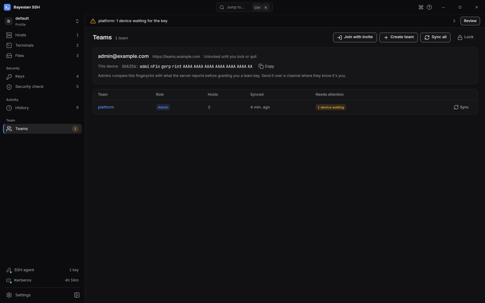

Sync exchanges changes with the team's sync server: new and updated team connections come down, your edits and audit events go up. Teams is local-first. You keep a full local copy, and an SSH connection never waits for a sync.

## Run a sync

```sh
bssh teams sync            # every team on this machine
bssh teams sync platform   # one team
```

A run pulls new entries and verifies them, pushes your edits, uploads queued audit events, and updates the team's connections in `bssh list`.

Each team prints a line with what changed: pulled and pushed counts, resolved conflicts, updated hosts, uploaded audit events, a rotated key. If a team fails, the others still run; the command then exits non-zero and names the teams that failed.

In the desktop app, sync from the Teams page: **Sync** next to a team, or **Sync all** in the header. Open a team and use **Sync** there to sync just that team. A sync also runs on its own when a key arrives while the Teams page is open.

## Work offline

Edits, shares and audit events wait locally until a sync reaches the server. A share made offline is queued: bssh says it will be shared once a sync goes through, and the next sync that succeeds sends it.

Nothing blocks on the network. You can list, connect to and work with team connections you already have.

## Conflicts

The vault is an append-only log of revisions per team. When two members edit the same connection, the conflict resolves last-writer-wins per entry, and the losing version stays in the server's history, so nothing is lost.

If you edited a connection that another member deleted, your edit is dropped and the sync says which entry it was.

## Entries that fail the checks

Every pulled entry is verified before it is applied. An entry from an unknown author, or one that does not continue the revision chain it claims, for example an old version relabelled as new, is rejected and reported with its revision and the reason.

Rejected entries are never applied, and sync continues with the rest. A server replaying old versions or an unknown author can cause this; tell your team admin. The desktop app keeps an **Integrity problems** notice on the team until a later sync comes back clean.

## What the desktop app shows

The **Teams** page lists your teams with your role, host count and last sync. Hover the sync time for the exact UTC time. **Needs attention** carries what is waiting for a person, and the Teams entry in the sidebar shows how many items are waiting:

- **Waiting for the key**: this device has joined but no admin has granted it the team key yet.
- **N devices waiting**: admins see the devices waiting for a key.
- **You were removed**: this device can no longer sync the team.
- **Integrity problems**: entries failed the checks above.
- **Audit log failed**: the audit log no longer verifies on this machine.
- **Audit chain broken**: the server's copy of your audit log is missing events this device uploaded before.
- **Rotation stopped**: a key rotation did not finish after a member was removed.

The page checks what needs attention every 30 seconds while it is open. An item stays listed until it is resolved.



## Next steps

- [Audit log](/teams/audit-log/) for what sync uploads and how it is verified.
- [Members and devices](/teams/members/) to grant a waiting device its key.
